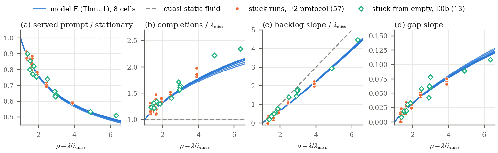

# Inside the Trap: A Renewal Law for Prefix-Cache Collapse in LLM Agent Serving

Code, data and registrations for the preprint by Akshat Valse and Ali Jannesari (Department of Computer Science, Iowa State University), [arXiv:2611.08902](https://arxiv.org/abs/2611.08902). Tag [`trap-arxiv-v1`](https://github.com/AkshatValse/surviving-llm-stampede/tree/trap-arxiv-v1) marks the commit the preprint describes; the manuscript source is in [`paper/`](paper/). The repository's name comes from an earlier draft of the paper, withdrawn before it was announced (*Branches and tags* below).

## The problem

An LLM agent that calls tools sends sessions of many turns to its serving engine: each prompt is the previous context plus the output of the tool just run. Prefix caching keeps the key-value (KV) state of the previous turn, so a follow-up turn whose prefix is still cached prefills only its new tokens. In our workload a hit prefills 551 tokens and a miss about 11,100 (a turn *hits* if more than half of its prompt is cached). The cached KV belongs to sessions that sit idle in tool calls, and admitting waiting work evicts it. A burst of new sessions can therefore tip the engine into a trap: every turn misses, the queue grows, the gap between a session's turns grows with it, and the backlog does not drain, at a load the engine served before.

## Main results

- **The trap.** We ran five registered paired tests (each test's rule was committed to git before its jobs were submitted; there is no third-party registry) on two engines (SGLang 0.5.22, vLLM 0.32.0), two GPUs (A100 80GB, H200 NVL) and two models (Qwen2.5-7B-Instruct, Llama-3.1-8B-Instruct), each at two arrival rates with three seeds. Each seed ran three arms on the same arrivals: a burst of 200 sessions (BURST), no burst (NOBURST) and the burst behind a client-side session cap (CAPPED). The registered rule (in at least two of three seeds: BURST trapped, that is, prefilling at the all-miss token rate, within 15%, with a backlog growing faster than half the excess of the arrival rate over the all-miss capacity defined below; NOBURST good; CAPPED recovered) was met at 9 of the 10 rates. It called 23 of the 30 BURST runs trapped; the tenth rate (Llama-3.1-8B at the lower rate) failed on the backlog-growth condition, which only one of its three BURST runs met. Still, in all 30 BURST runs the burst left the engine at zero hits to the end of the run, every NOBURST run stayed in the good, cache-hitting state, and the cap prevented the trap in all 30 CAPPED runs.
- **A renewal law.** The paper idealizes the trapped engine as a fluid FIFO server on which every turn misses (model F). Following a FIFO orbit (the time a request joins, the time it completes and its session's next turn joins, and so on), it proves that the cycle lengths obey a linear renewal recursion. The model's drain threshold is its all-miss capacity λ<sub>miss</sub>, computed from a cost model fitted to server-log timings (for vLLM, the H200 and Llama, scaled by one speed factor fitted to the all-miss token rate measured for that engine, GPU and model with prefix caching disabled). It is within 4% of the all-miss capacity measured on the engine with prefix caching disabled and 32 sessions kept running: the rate at which the engine completes sessions when every turn misses and the turns are in their normal mix, which is what "the all-miss capacity" means elsewhere in this README. As is classical, model F's trap drains if and only if arrivals are below λ<sub>miss</sub>. Above it, the recursion's Perron root carries every trapped state to a known self-similar regime in which the gap between a session's turns grows linearly.
- **A youth premium.** In that regime the turns served are young (early in their sessions) and short, so for our workload model F completes sessions faster than λ<sub>miss</sub> at every load the paper checked. In the model, a cut in arrivals to just below a trap's measured throughput therefore does not clear it; only a cut below λ<sub>miss</sub> does.
- **The law on the engine.** With nothing fitted to trap data, model F matches, retrospectively, 57 stuck runs of the paired-test protocol (follow-up hit fraction below 0.2 over the last 3000 s of the run; the 30 BURST runs above are among them): the mean served prompt within 3% in 50 of them, completions above the all-miss capacity in every run, and the pooled growth of the gap between turns.
- **Blind tests.** Some predictions were frozen before the runs they score existed (blind in outcome). Four runs trapped with no burst, by a temporary slowdown of tool calls, met 4 of the 5 pre-set scores. Arrivals cut to 1.15 times the all-miss capacity, below the 1.32-1.41 times at which the same seeds' uncut traps completed sessions, left all three traps in place to the end of the run. After a cut to 0.85 times it, the backlogs shrank only slowly, and all three runs were still trapped at the end, 6300 s after the cut. Both outcomes are what model F predicted. With sessions that nearly all run exactly 20 turns, for which the model predicts completions below the all-miss capacity, trapped runs did complete below it.
- **Two ways out.** Refusing arrivals drains a trap by shedding sessions. A session cap restores cache reuse: in registered tests it rescued 9 of 9 established traps at the same load without shedding a session, at a price of 386-569 s of waiting at the client per paused session on average, and the engine stayed good after the cap was removed.
- **Limits.** Model F is an idealization, and the paper does not prove that the engine converges to it. Sessions are synthetic (exponential 5 s tool times, no shared prefixes), and the models are dense and 7-8B in size.



*The paper's Fig. 2: model F (blue lines, one for each of the eight cells, that is, each combination of engine, GPU, model and KV-pool size tested; no parameter fitted to any trap measurement) against the 57 stuck runs of the paired-test protocol (orange; "E2 protocol" in the legend) and 13 runs that got stuck from an empty start (green; "E0b"), as a function of the load ρ = λ/λ<sub>miss</sub>, the session arrival rate over model F's all-miss capacity. Dashed gray: the quasi-static fluid model read literally in congestion (the stationary turn mix, completions at λ<sub>miss</sub>, backlog growth at ρ − 1). The check is retrospective: the theory was derived after these runs were read.*

## What is in the repository

| Path | Contents |
|---|---|
| `paper/` | The manuscript source (`main.tex`, `sections/`, `refs.bib`) and figures (`figs/`), a local build (`main.pdf`), `NUMBERS.md` (every number in the paper with its source file and commit or Slurm job) and `derived/` (tables computed from committed run data) |
| `src/prefixmeta/` | Discrete-event simulator of a continuous-batching engine with prefix caching |
| `src/agentload/` | Real-engine load generator, mock server, cache-flush canary and client-side session gate |
| `analysis/` | Analysis code, including the scorers that apply the registered rules (their verdicts are written under `results/`); `analysis/theory/` holds the first-principles model of the throughput curve and model F |
| `configs/`, `prereg/` | Experiment configurations, registrations (`configs/*prereg*.yaml`) and their inputs |
| `experiments/`, `calibration/` | Simulator and prediction run scripts; the simulator's cost model, fitted to engine server-log timings |
| `slurm/` | Job scripts for the engine runs |
| `scripts/traces/` | Download and parsing scripts that reduce the public TraceLab and mini-SWE-agent traces to the summary statistics in `results/traces_summary/` and the trace workload configurations `configs/workload_trace_*.yaml` |
| `env/` | The pinned local Python environment (`requirements-local.txt`) |
| `results/` | Real-engine data pulled from the cluster (`results/nova/`: requests, metrics, server and job logs) and the reports, verdicts and summaries of analysis and simulator runs |
| `figures/` | The scripts behind the paper's figures |
| `notes/` | Research log (`LOG.md`), status, runbooks, theory notes, frozen predictions and review and verification reports |
| `tests/` | One pytest suite |
| `provenance/` | `commit-map-public.tsv` (the development repository's commit hashes to this repository's), `REDACTIONS.md` (what the public copy changed, and the public-release commits), `REGISTRATIONS.md` (the registrations and how to check them), `registration-proofs/`, and the GitHub push logs and Slurm accounting records; `provenance/README.md` describes the records archived before the public release |

**Data policy.** `results/nova/` (real-engine data) and `results/vat_alignment/` and `results/vat_collect/` (wall-clock timing measurements of the archived VAT pilot, tag `archive/pilot-vat`, which the paper does not use; a rerun does not reproduce them exactly) are tracked in full. Full simulator outputs are not stored, apart from their summaries; each can be regenerated from the command, commit and configuration recorded with the run (`meta.json`, `config.yaml`). The commits recorded there, in `paper/NUMBERS.md`, in the notes and in the job logs are the development repository's; `provenance/commit-map-public.tsv` maps them to this repository's (for the 103 commits made before the history rewrite of 2026-10-22, first through `provenance/commit-map.tsv`).

## Getting started

### Clone

```bash
git clone https://github.com/AkshatValse/surviving-llm-stampede.git
cd surviving-llm-stampede
```

On Windows, add `-c core.autocrlf=false -c core.longpaths=true` after `git clone`. By default Git for Windows converts line endings on checkout, which changes the bytes of the registrations and scripts that several tests check, and the longest path in the repository has 166 characters, so a clone in a deeply nested folder can exceed the 260-character path limit.

The download is about 1 GB, and checking out `trap/arxiv` writes about 14 GB of files, nearly all of them the real-engine data in `results/nova/`, so a clone needs about 15 GB of free disk space.

### Python environment

Use Python 3.12 and the pinned versions in `env/requirements-local.txt`. Newer NumPy and pandas versions should give the same verdicts but may change low-order digits of simulator results.

```bash
python3.12 -m venv .venv    # Windows: py -3.12 -m venv .venv
echo .venv/ >> .git/info/exclude
source .venv/bin/activate    # Windows: see below
python -m pip install -r env/requirements-local.txt
python -m pytest
```

The second line keeps the environment out of `git status`: simulator runs record in `meta.json` whether the working tree was clean (untracked files count as dirty), some reports flag results from a dirty tree, and the round-5 runner refuses a registered (non-quick) run on one. On Windows, activate the environment with `.venv\Scripts\activate` in cmd, `.venv\Scripts\Activate.ps1` in PowerShell (if its execution policy allows local scripts) or `source .venv/Scripts/activate` in Git Bash; in PowerShell, add the line `.venv/` to `.git/info/exclude` with an editor, since its `echo` would write the file in UTF-16. The commands below assume the environment is active.

The recorded local results and test runs come from two machines with the pinned versions: a MacBook Pro (Apple M3 Max, Python 3.12.7) and a Windows 11 PC (Python 3.12.10). A run's `meta.json` names its machine in `hostname`; its `hardware` field reads "Apple M3 Max CPU (simulation)" on both, because it is a hard-coded string.

The suite has about 1,950 tests and takes about 25 minutes on that PC. There, with a clone made as above, 32 of them fail for platform reasons, the same 32 that `notes/PREDICTIONS.md` (section 7) records for an earlier commit: last-bit differences in the simulator's bit-identity tests, tests that run the Slurm job scripts locally or check client timing, signal handling or file-descriptor limits, and one test whose temporary directory name contains colons. The job-script tests of the cap and burst modes fail on any machine with `nvidia-smi` (on that PC they are among the 32), because their test calibration records a machine without one. One test compares the theory code with a frozen tag, so it fails in a clone without the tags, such as a shallow one; `git clone` fetches them.

### Numbers, tables and figures

- `paper/NUMBERS.md` lists every number in the paper with its source file and its commit or Slurm job. The paper's Appendix E.13 gives the data directory and commit behind each result.
- `python figures/paper/derived_numbers.py` recomputes 13 of the 16 tables in `paper/derived/` from committed run data; the three `loopvars_*.csv` come from a frozen script whose runs `paper/NUMBERS.md` records (source LV).
- `paper/figs/README.md` names the script behind each of the paper's figures and what it reads (for Fig. 3, the docstring of `figures/paper/fig_rescue.py` names its input). `bash figures/paper/build_all.sh` rebuilds Figs. 1 and 5-8 (and five figures the paper no longer uses) and runs as is on Linux, macOS and Windows (Git Bash): the scripts that import repository code put it on the Python path themselves, so the advice in `paper/figs/README.md` to change the script's `PYTHONPATH` on Linux or macOS is unnecessary.
- With the pinned environment, `derived_numbers.py` and `build_all.sh` reproduce their committed outputs byte for byte from a fresh clone (checked on the Windows PC).
- Figs. 2-4 have scripts of their own: `figures/theory_icml/fig_trap_universality.py`, `figures/paper/fig_rescue.py` and `figures/r16/fig_mirror.py`. The first and the third import `analysis`, so run them from the repository root with `PYTHONPATH=src:.` (in Git Bash on Windows, quoted: `PYTHONPATH="src;."`). `fig_mirror.py` writes `results/theory/r16/fig_mirror.pdf`, of which `paper/figs/fig_mirror.pdf` is a copy, and draws the measured MIRROR runs only when their run directories are passed with `--mirror-runs`; the paper's figure used the three BURST runs of jobs 17264055-57, `20261105-145227`, `20261105-145244-2` and `20261105-145240` under `results/nova/r16_mirror_1726405x_pulled_20261105-1722/results/agentload_e2_burst/`. `fig_trap_universality.py` and `fig_mirror.py` write PDFs that carry a creation date, so their rebuilds are not byte-identical, and they overwrite tracked files (`paper/figs/fig_trap_universality.*`, `results/theory/r16/fig_mirror.*`); `git checkout -- paper results/theory/r16` restores them.
- To build the paper, run `pdflatex main`, `bibtex main` and then `pdflatex main` twice more in `paper/`. This overwrites the committed `paper/main.pdf`; `git checkout -- paper/main.pdf` restores it.

### Engine runs

The engine runs used Slurm on Iowa State University's Nova cluster: SGLang 0.5.22 or vLLM 0.32.0 serving Qwen2.5-7B-Instruct or Llama-3.1-8B-Instruct on one NVIDIA A100 80GB PCIe or H200 NVL. `slurm/sglang_job.sbatch` and `slurm/vllm_job.sbatch` run them, and `slurm/setup_nova.sbatch` and `slurm/setup_vllm_env.sbatch` build their environments; the job logs under `results/nova/` record the exact `pip freeze` of the engine and load-generator environments. For a registered test, the job checks the registration file (`python -m analysis.prereg check-job`) before it starts and writes the file's SHA-256 into every run's `meta.json`. The job scripts stop unless they run under the cluster account, partition and QoS they were written for, so they need editing before they run elsewhere.

## Checking the registrations

Every registration and blind prediction in the paper was committed and pushed to GitHub before the data it concerns was read, except where the paper's Appendix E.12 says otherwise. The paper cites the commit hashes of the authors' development repository, which stays private; this repository's hashes differ (next section). [`provenance/REGISTRATIONS.md`](provenance/REGISTRATIONS.md) lists each registration with its original commit, its tag, its commit here, its first push to GitHub and its Slurm jobs, and says how to check them. The main check is one command, run from the repository root of a git clone (it needs the history and the tags, which `git clone` fetches):

```bash
python provenance/registration-proofs/verify.py
```

It needs only Python 3.8 or later and git, not the environment above, and ends with `28 proofs, 0 failures` (exit status 0). It recomputes each original commit hash from stored raw objects, follows the parent chain to the commit GitHub's push log recorded, and checks that the original code, configuration and data trees, the registered files, the commit dates and messages and the tags (apart from the commit each points to) are identical to this repository's. It reports the redacted notes files that two registrations include as differing, by design.

## How this repository relates to the development repository

This repository's history is a redacted copy of the authors' private development repository, `AkshatValse/Nova-Research`, whose commit hashes the paper cites. Four of its notes files hold information about other people and an unrelated project, so passages of those files and a clause in each of two commit messages were redacted; five local tool-configuration files were removed from every commit; and an older name and e-mail address of the first author were replaced by a mailmap. No code, experiment configuration, registration or data file differs in any commit of that history, except the redacted notes files that two registrations include. Six commits of the original that hold nothing cited are not published (five of a side branch and GitHub's test merge commit for an unmerged pull request from it).

On `trap/arxiv`, public-release commits follow that history. The one tagged `trap-arxiv-v1` adds the licenses, `NOTICE`, the public-release files in `provenance/` and the README's sections for readers of the paper (now in `provenance/REGISTRATIONS.md`), and makes the small edits that `provenance/REDACTIONS.md` lists, among them rewording a few lines of notes and Slurm comments, putting a placeholder for another allocation's account name in the tests, dropping the lines naming local tool files from `.gitignore` and adding a fallback to the freeze check of `analysis/theory/pred2/common.py`. The later ones change only documentation. [`provenance/REDACTIONS.md`](provenance/REDACTIONS.md) gives the details, and `provenance/commit-map-public.tsv` maps the original hashes to this repository's. The development repository is kept unchanged; reviewers can get read access to it on request.

## Branches and tags

- **`trap/arxiv`** (the default branch) is this version of the paper. Tag `trap-arxiv-v1` marks the commit the arXiv version describes; the commits after it change only documentation.
- `r10/arxiv` (tag `arxiv-v1`) is an earlier draft of the paper, *Surviving an Agentic LLM Stampede*, which was withdrawn from arXiv before it was announced and gave this repository its name. It was published here on 2026-11-04 and is left unchanged with its own public-release commit; `trap/arxiv` continues the same development history.
- `main` is the earlier development line; the result branches below were merged into `r10/arxiv` and so into `trap/arxiv`, except `wip/r6-separate-batching`, whose one unmerged commit (`6ea9f0c`; `fc870c2` in the development repository) is an interrupted, unreviewed work in progress that `paper/NUMBERS.md` and `provenance/README.md` cite for its push time.
- Other published branches, kept because frozen tags or cited commits are on them: `r11/lpminf`, `r11/rescue`, `r11/strengthen`, `r12/h200`, `r12/h200-prereg`, `r12/llama31`, `r12/llama31-predict`, `r12/llama31-theory-cond`, `r13/pool-sweep`, `r13/pred2`, `r13/theory`, `r14/extra`, `r6/validation`, `r8/native-predict`, `r9/vllm-predict`, `r9/vllm-register`, `wip/r6-separate-batching`.
- Frozen registration and prediction tags: `icml-cut-pred`, `icml-trap-pred`, `r11-basin-reg`, `r11-lpminf-pred`, `r11-rescue-pred`, `r11-rescue-reg`, `r12-llama31-predictions-frozen`, `r13-theory-pred`, `r13-theory-pred2`, `r14-basin2-reg`, `r14-extra-reg`, `r15-cut-reg`, `r15-reg`, `r16-mirror-reg`, `r6-predictions-frozen`, `r8-native-predictions-frozen`, `r9-vllm-predictions-frozen`.
- The `archive/*` tags (`archive/harness-prefix-meta`, `archive/pilot-delay-eos`, `archive/pilot-kvrent`, `archive/pilot-prefix-meta`, `archive/pilot-vat`) are earlier lines of work kept for provenance. They include killed directions (KV rent-or-buy, statistically valid agentic tuning, delayed-gradient edge of stability) that `notes/DIRECTIONS.md` and `notes/LOG.md` explain.
- The original repository's other branches, named in `provenance/ls-remote-2026-11-06.txt`, are not published; every commit on them is on a published branch or tag, except five commits of 2026-11-03 on the side branch `claude/inspiring-mendel-iofn3w`, which hold nothing cited. Some notes mention these branches by name. The snapshot also lists `refs/pull/1/head` and `refs/pull/1/merge`, GitHub's refs for an unmerged pull request from that side branch into `main`; they are not published either. `refs/pull/1/head` is the side branch's tip, and `refs/pull/1/merge` is `b015b50`, the test merge commit GitHub made for the pull request on 2026-11-03, which has the same tree as that tip.

## Citation

```bibtex
@misc{valse2026inside,
  title         = {Inside the Trap: A Renewal Law for Prefix-Cache Collapse in {LLM} Agent Serving},
  author        = {Valse, Akshat and Jannesari, Ali},
  year          = {2026},
  eprint        = {2611.08902},
  archivePrefix = {arXiv},
  primaryClass  = {cs.DC},
  url           = {https://arxiv.org/abs/2611.08902}
}
```

## License

- Code (everything outside `results/` and `paper/`): MIT License, see `LICENSE`.
- Data in `results/`: Creative Commons Attribution 4.0 International (CC BY 4.0), see `LICENSE-DATA`.
- The manuscript source in `paper/`: the license of the paper's arXiv version.
- Third-party material (TraceLab and mini-SWE-agent trace statistics; Qwen2.5, Llama 3.1, SGLang and vLLM as measured systems): see `NOTICE`.

## Contact

Akshat Valse (corresponding author), avalse@iastate.edu.
